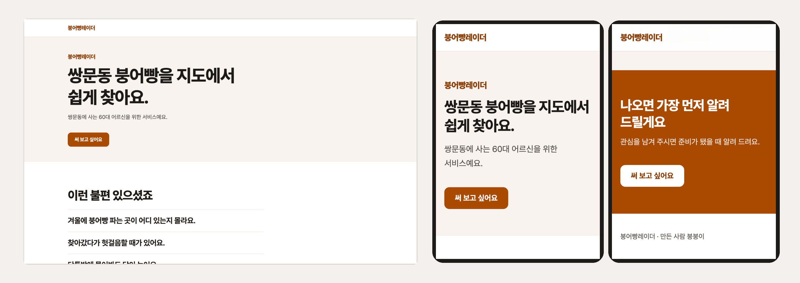

<div align="center">

# 내 서비스 랜딩페이지 만들기

**도봉여성새로일하기센터 · AI 기반 디지털 마케터 양성과정 · 2026.10.12 실습**

코딩을 몰라도 코덱스(Codex)에게 말로 시켜서<br>
내 서비스를 소개하는 랜딩페이지를 만들고, 인터넷에 올리고, 써 보고 싶은 사람이 있는지 확인합니다.



<sub>예시 「붕어빵레이더」 · 첫 화면부터 「써 보고 싶어요」 버튼까지</sub>

</div>

<br>

## 오늘 만드는 것

| | 무엇 | 어디에 |
|---|---|---|
| 1 | 인터뷰로 정리한 서비스 기획서 | `작업파일/서비스기획.md` · `내 서비스 기획서.docx` |
| 2 | 내 서비스 소개 랜딩페이지 한 장 | `내사이트/` → `xxxx.vercel.app` |
| 3 | 「써 보고 싶어요」 버튼과 신청 폼 | 구글 폼 · 네이버 폼 (직접 만들기) |

서비스를 다 만들기 전에, 써 볼 사람이 있는지부터 확인하는 방식입니다(수요 조사). 서비스 화면은 신청을 보고 나중에 만듭니다.

<br>

## 시작하기

**준비물** · ChatGPT 앱(Codex) · Node.js(무료, [nodejs.org](https://nodejs.org) 의 LTS) · 구글 계정

**1. 받기**
1. 이 페이지 위 초록색 **Code** → **Download ZIP**
2. 압축을 풀면 `20261012_dobong_my-project-main` 폴더가 생깁니다
3. 폴더 이름을 `my-project` 로 바꿉니다

**2. 열기**
1. ChatGPT 앱 → 왼쪽 위 **Codex**
2. 입력창 위 **프로젝트 선택** → `my-project` (옆의 「이 컴퓨터」는 그대로)

**3. 보내기**

```
$start 로 처음부터 도와주세요
```

허락 창이 뜨면 **허용** 을 누릅니다.

<br>

## 보낼 문장과 생기는 것

| 단계 | 코덱스에 보내는 것 (또는 할 일) | 생기는 것 |
|---|---|---|
| 시작 | `$start 로 처음부터 도와주세요` | 첫 질문 |
| 인터뷰 | 질문 일곱에 한 줄씩 · 되물으면 「네」 | `작업파일/인터뷰기록.md` |
| 기획 | `좋아요` | `작업파일/서비스기획.md` |
| 만들기 | 허락 창이 뜨면 「허용」 | 랜딩페이지 · 기획서.docx · `작업파일/신청폼_문항.md` |
| 고치기 | `맨 위 제목 글씨를 더 크게 고쳐 주세요. 다른 곳은 그대로 두세요.` | 고친 화면 |
| 폼 만들기 | (직접) 구글 폼 · 네이버 폼에 `신청폼_문항.md` 옮겨 적기 | 폼 주소 |
| 폼 잇기 | `신청 폼 연결해 주세요: (폼 주소)` | 버튼을 누르면 폼이 열림 |
| 올리기 | `내사이트를 Vercel 에 무료로 올려 주세요.` | `xxxx.vercel.app` 주소 |
| 다듬기 | `$design 으로 이 사이트 느낌으로 내 사이트를 다듬어 주세요.` + 마음에 드는 사이트 주소 | 색 · 글꼴 · 여백만 바뀐 화면 |

서버 없는 파일로 만들어져서 Vercel 말고도 어디든 올릴 수 있습니다. `다른 곳에 올릴 파일로 만들어 주세요` 를 보내면 zip 하나로 묶어 주고, `내 도메인 연결하고 싶어요` 로 산 도메인을 이을 수 있습니다.

고친 뒤에는 `다시 올려 주세요` 를 보내야 인터넷 주소에도 보입니다. 더 많은 문장과 막혔을 때 질문과 답은 [가이드북](가이드북.md) 에 있습니다.

<br>

## 폴더 안에 무엇이 있나

```
my-project/
├── AGENTS.md          규칙서 · 코덱스가 항상 먼저 읽는 설명서
├── 가이드북.md          보낼 문장 모음 · 막혔을 때
├── 사이트재료_예시.md    9/14 보고서가 없을 때 쓰는 예시 재료
├── 내사이트/            내 랜딩페이지 (Next.js)
│   ├── data/site.js     서비스 이름 · 한 줄 약속 · 소개 글 · 신청 폼 주소
│   └── app/globals.css  색 · 글꼴 · 크기 (맨 위 한 줄이 내 색)
└── .agents/skills/      기술 세 개 ($ 를 붙여 부름)
    ├── start/           인터뷰 → 기획 → 랜딩페이지 + 신청 폼 문항
    ├── update/          신청 폼 연결 · 공지 바꾸기 · 다시 올리기
    └── design/          내가 찾은 사이트 느낌으로 다듬기
```

맥에서 `.agents` 폴더가 안 보이면 Finder 에서 `Command + Shift + .`

<br>

## 지켜 주세요

- **서버 없는 판입니다.** 로그인 · 결제 · 게시판 · 예약은 넣지 않고, 신청은 내가 만든 폼으로 받습니다.
- 실명 · 전화번호 · 주소는 넣지 않고 별명을 씁니다.
- 후기 · 숫자 · 이용자 수를 지어내지 않고, 아직 없는 서비스를 있는 것처럼 쓰지 않습니다.
- 폼에서 연락처를 받으면 「출시 알림에만 쓰고 알림 뒤 지웁니다」 안내를 붙입니다.
- 남의 사진 · 로고 · 글은 가져오지 않습니다.

<br>

## 막혔을 때

| 증상 | 해결 |
|---|---|
| 기술이 안 보여요 | **프로젝트 선택** 으로 `my-project` 를 다시 고르기. 폴더가 한 겹 더 들어가 있지 않은지 보기 |
| 아무 반응이 없어요 | 화면 아래 허락 창 → **허용** |
| 「한도」라고 나와요 | 잠시 뒤 같은 문장 다시 보내기 |
| 화면이 안 열려요 | `화면 다시 띄워 주세요` · http://localhost:3000 |
| Node.js 가 없대요 | 손 들고 강사에게 설치 부탁 |
| 버튼을 눌러도 폼이 안 열려요 | `신청 폼 연결해 주세요: (폼 주소)` → `다시 올려 주세요` |

<br>

<div align="center"><sub>지금.lab 남우진 · 2026.10.12</sub></div>
